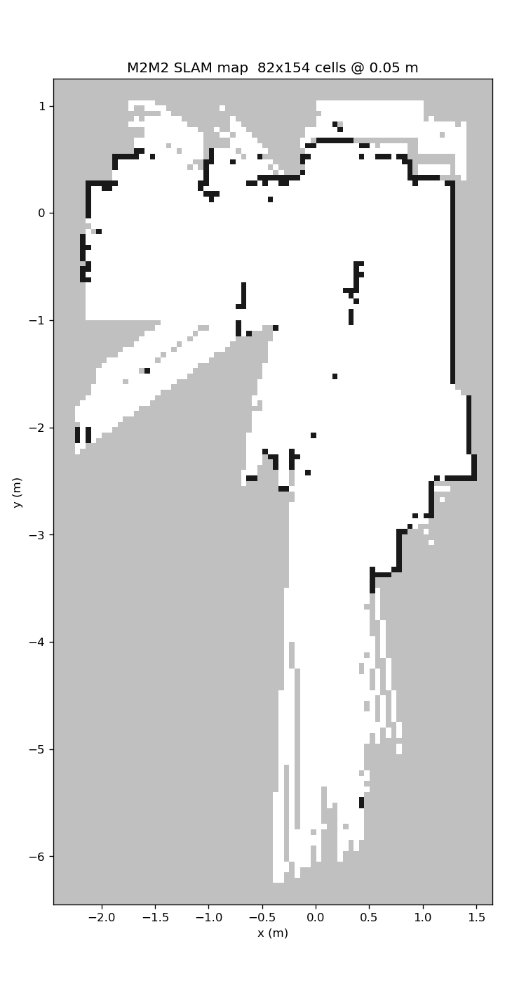

# Slamtec Mapper M2M2 LiDAR：ROS 2 Jazzy 測試、RViz2 與內建 SLAM 地圖紀錄（2026-10-29）

**中文** | [English](README.en.md)

環境：Ubuntu 24.04、ROS 2 Jazzy、x86 筆電，M2M2 用網路線直接接筆電，`ROS_DOMAIN_ID=99`

結果：
- M2M2 實際掃描約 **10.8 Hz**，每圈 853 點、完整 360°，距離讀數合理
- 用開放原始碼驅動 [hatchbed/opensw_ros](https://github.com/hatchbed/opensw_ros) 發布 `/scan`。它是 2022 年寫的，要改 3 個地方才能在 Ubuntu 24.04 + Jazzy 上編譯和執行（[說明](docs/zh/driver-patches.md)）
- 寫了 `m2m2_slam_bridge.py`，直接讀 M2M2 **內建 SLAM** 的地圖和位置，發布成 `/map`、`/m2m2/pose` 和 TF `map → laser`，可以在 RViz2 看建圖結果
- **供電要注意**：M2M2 是 5V、最高約 1.3A。OpenCR 的 5V 輸出供得起，但**電源插頭一定要插緊、固定好**，接觸不良會一直斷電重開（2026-10-31 更正，見 [nuc.md](nuc.md)）



## 文件
| 文件 | 內容 |
|---|---|
| [README.md](README.md) | 硬體、接線、安裝、啟動與測試結果（本文件） |
| [docs/zh/driver-patches.md](docs/zh/driver-patches.md) | opensw / opensw_ros 在 Ubuntu 24.04 + Jazzy 上的三個修正 |
| [docs/zh/protocol.md](docs/zh/protocol.md) | M2M2（Slamware）通訊協定、地圖格式與網頁 API 筆記 |
| [docs/zh/troubleshooting.md](docs/zh/troubleshooting.md) | 問題排解：斷電重開、連不上、編譯失敗、Segmentation fault |
| [conversation.md](conversation.md) | 測試過程紀錄（摘要） |
| [jetson.md](jetson.md) | Jetson（aarch64）上的接線、編譯與測試紀錄 |
| [nuc.md](nuc.md) | Intel NUC 上的測試紀錄：供電結論更正、斷線後驅動當掉 |

## 檔案說明
- `setup_workspace.sh`：建立 `~/m2m2_ws`，下載上游驅動（固定版本）、套用修正並編譯
- `patches/opensw.patch`、`patches/opensw_ros.patch`：對上游驅動的修正
- `scripts/m2m2_slam_bridge.py`：把 M2M2 內建 SLAM 的地圖與位置發布到 ROS 2
- `scripts/slamware_client.py`：Slamware 通訊協定的最小 Python 用戶端（位置、地圖範圍、地圖）
- `scripts/scan_check.py`：訂閱 `/scan` 6 秒，統計頻率、點數、距離與各方向最近障礙物
- `scripts/render_map.py`：把目前的地圖、雷射和位置存成 PNG
- `rviz/m2m2.rviz`：RViz2 設定（地圖、雷射、位置、TF）
- `launch/tb3_m2m2.launch.py`：TurtleBot3（OpenCR）＋ M2M2 整合啟動檔
- `rviz/tb3_m2m2.rviz`：整合用的 RViz2 設定（多了機器人模型）
- `images/m2m2_map.png`：測試時的地圖

## 硬體與接線
| 項目 | 內容 |
|---|---|
| 型號 | Slamtec Mapper 2 model 2（M2M2），韌體 `4.6.1-rtm`（2023-11-28） |
| 供電 | **5V**，650–1300 mA（不是 12V） |
| 介面 | 100 Mbps 乙太網路；也會自己發 Wi-Fi 熱點 `SLAMWARE-xxxxxx` |
| 預設 IP | `192.168.11.1`（有線網路孔會當 DHCP 伺服器） |
| 連接埠 | 1445（Slamware SDK）、80（網頁管理介面）、22（SSH） |

```
OpenCR 5V 輸出（或 5V 2A 以上的 USB 充電頭）──► M2M2 轉接板 ◄── 網路線 ──► 筆電有線網路孔（192.168.11.x）
```

> ⚠️ M2M2 的**電源插頭要插緊並固定**（熱熔膠、束帶等）。插頭鬆了會在開機或走動時斷電重開。一開始以為是 OpenCR 5V 電流不夠，2026-10-31 在 NUC 上把插頭壓緊後，接 OpenCR 5V 穩定跑了約 18 分鐘。詳見[問題排解](docs/zh/troubleshooting.md#m2m2-一直斷線重開)。

## 筆電網路設定
M2M2 的有線網路孔有 DHCP 伺服器，通常會自動分到 `192.168.11.200`，不用設定。如果沒有自動拿到 IP，再用 NetworkManager 建一個固定 IP 的有線連線：
```bash
nmcli con add type ethernet ifname enp3s0 con-name mapper \
  ipv4.method manual ipv4.addresses 192.168.11.100/24 ipv6.method link-local
nmcli con up mapper
ping 192.168.11.1
```
`enp3s0` 換成你的有線網路介面名稱（用 `ip -br link` 查）。

## 安裝與編譯
```bash
sudo apt install libasio-dev nlohmann-json3-dev
git clone https://github.com/asdfut/slamtec-m2m2-lidar.git
cd slamtec-m2m2-lidar
./setup_workspace.sh          # 建在 ~/m2m2_ws，約 3–5 分鐘
```
其他需要的套件（`libeigen3-dev`、`libspdlog-dev`、`libopencv-dev`、`libassimp-dev`）Jazzy 桌面版通常已經有了。`nlohmann-json3-dev` 在 NUC 和 Jetson 上都沒有預裝。

## 啟動
三個終端機都要先 `export ROS_DOMAIN_ID=99`。

```bash
# 1. 雷射驅動 → /scan（frame: laser）
source ~/m2m2_ws/install/setup.bash
ros2 run opensw_ros laser_driver --ros-args -p host:=192.168.11.1 -p frame_id:=laser -p rate:=10.0

# 2. 內建 SLAM 橋接 → /map、/m2m2/pose、TF map → laser
source /opt/ros/jazzy/setup.bash
python3 scripts/m2m2_slam_bridge.py

# 3. RViz2
rviz2 -d rviz/m2m2.rviz
```
- `laser_driver` 的 `frame_id` 預設寫成 `imu`，要指定成 `laser`
- `rate` 預設 50，但 M2M2 一秒只轉約 10 圈，設成 10 才不會發布重複的掃描
- 拿著 M2M2 慢慢走，RViz2 裡的地圖會跟著展開
- M2M2 斷電重開後 `laser_driver` 會因 `Broken pipe` 結束，要等 1445 重新打開後手動重開（[問題排解](docs/zh/troubleshooting.md#m2m2-重開後-laser_driver-當掉)）

## 搭配 TurtleBot3（OpenCR）
把 M2M2 當成 TurtleBot3 Burger 的雷達。先安裝 TurtleBot3 套件，並把使用者加進 `dialout` 群組（重新登入後生效）：
```bash
sudo apt install ros-jazzy-turtlebot3 ros-jazzy-turtlebot3-msgs ros-jazzy-dynamixel-sdk ros-jazzy-turtlebot3-teleop
sudo usermod -aG dialout $USER
```
啟動：
```bash
export ROS_DOMAIN_ID=99
source ~/m2m2_ws/install/setup.bash
ros2 launch launch/tb3_m2m2.launch.py rviz:=true
```
- 會一起啟動 `robot_state_publisher`、`turtlebot3_node`（OpenCR）、`laser_driver`、SLAM 橋接，不會啟動 TurtleBot3 預設的 LDS 雷達
- TF：`map →（M2M2 SLAM）→ odom →（輪子里程計）→ base_footprint → … → base_scan → laser`。橋接用 `odom_frame:=odom` 模式，把 M2M2 的位置換算成 `map → odom` 發布
- M2M2 的安裝位置用 `laser_x`、`laser_y`、`laser_z`、`laser_yaw`（相對 `base_scan`）調整；裝反了就加 `laser_yaw:=3.1416`
- `laser_driver` 設成斷線當掉後 5 秒自動重啟
- 鍵盤控制：`TURTLEBOT3_MODEL=burger ros2 run turtlebot3_teleop teleop_keyboard`

## 測試結果
用 `scripts/scan_check.py` 量測（M2M2 放在桌上）：

| 項目 | 結果 |
|---|---|
| 實際掃描頻率 | 約 10.8 Hz（驅動用 50 Hz 發布時，約 4/5 是重複的一圈） |
| 每圈點數 | 853 點，角度解析度 0.422° |
| 角度範圍 | −179.7° ～ +179.9° |
| 有效點 | 554 點（65%） |
| 距離 | 0.24 ～ 5.58 m，中位數 1.18 m |
| 網路穩定度 | 插頭壓緊後連續 2 分鐘以上沒斷（NUC 上接 OpenCR 5V 約 18 分鐘） |
| 內建 SLAM 地圖 | 約 4 × 7.6 m，0.05 m／格 |

## 授權
- 本專案的腳本與文件：自由使用
- `patches/` 是對 [hatchbed](https://github.com/hatchbed) 的 opensw、opensw_ros 的修改，上游為 BSD 3-Clause 授權
