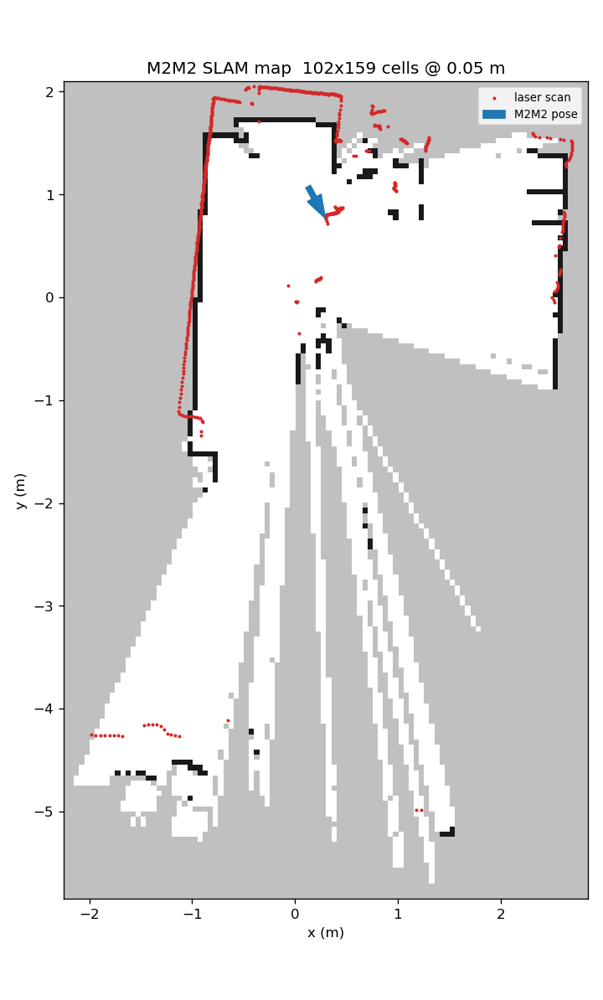

# Jetson test log (2026-10-30)

[中文](jetson.md) | **English** | [Back to README](README.en.md)

Setup: NVIDIA Jetson (L4T, kernel 6.8.12-tegra, aarch64, 7.3 GB RAM), Ubuntu 24.04, ROS 2 Jazzy. The M2M2 is cabled to the Jetson's Ethernet port `enP8p1s0`; the OpenCR is on USB.

## 1. Wiring and detection
- **OpenCR**: not visible on USB at first; after switching to a data-capable USB cable on a USB-A port it showed up as `/dev/ttyACM0` (`0483:5740`, ROBOTIS OpenCR Virtual ComPort)
- The user must be in the `dialout` group (`sudo usermod -aG dialout $USER`, then log in again) to open `/dev/ttyACM0`
- **M2M2**: completely dark when powered from the OpenCR 5V output; on a USB charger, once the plug was pressed in firmly, the Ethernet link came up
- No manual IP needed on the Jetson: the M2M2's DHCP gave it `192.168.11.200`; `192.168.11.1` answers ping, ports 1445 and 80 are open

## 2. Build
- `setup_workspace.sh` failed at `source /opt/ros/jazzy/setup.bash` (`AMENT_TRACE_SETUP_FILES: unbound variable`) because the script uses `set -u`. Fixed by relaxing `-u` around the source
- `sudo apt install libasio-dev nlohmann-json3-dev` is needed first (not preinstalled on the Jetson)
- 4 packages took 10 min 17 s; `hatchbed_common` alone took 7 min 34 s because it also builds its tests

## 3. Scan test
- `rate:=10` crashes the driver: `parameter 'rate' has invalid type ... {double}, setting it to {integer} is not allowed`; use `rate:=10.0` (README fixed)
- `scripts/scan_check.py` result:

| Item | Result |
|---|---|
| Scan rate | 10.2 Hz |
| Points per revolution | 857, 650 valid (76%) |
| Angle range | −179.8° to +179.8°, 0.42° per point |
| Distance | 0.32 to 6.17 m, median 1.04 m |

## 4. SLAM bridge and RViz2
- `m2m2_slam_bridge.py` publishes `/map`, `/m2m2/pose` and TF `map → laser` as expected
- RViz2 runs directly on the Jetson desktop (`DISPLAY=:1`)
- The map is about 5 × 8 m (102 × 159 cells at 0.05 m):

## 5. Driver stuck after the lidar reboots
- A loose charger plug made the M2M2 lose power and reboot (`enP8p1s0` link down → link up 13 s later)
- `m2m2_slam_bridge.py` reconnects by itself, but `laser_driver` stays at `Connecting to [192.168.11.1:1445] ...` and never recovers; restart the driver
- Secure the power cable
